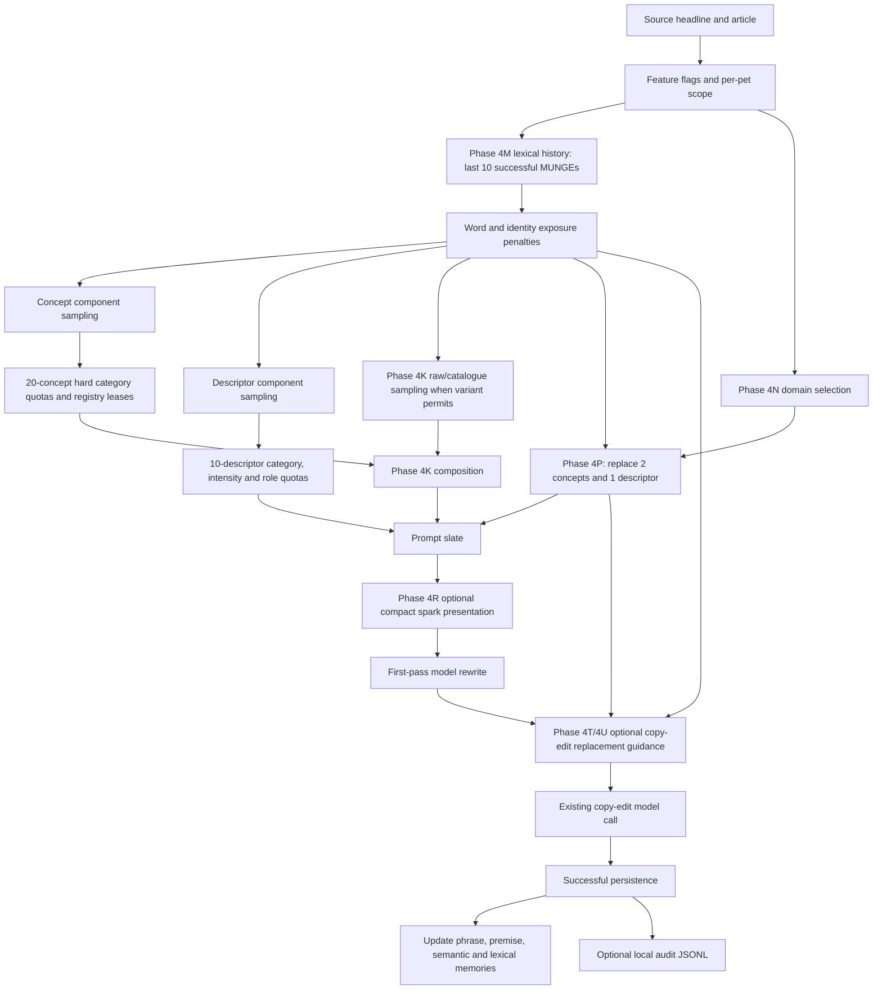

# NewsMuncher Phase 4V — ingredient selection and repetition root-cause investigation

Date: 2026-10-13

## Scope

This is an investigation only. It changes no generator, prompt, selector,
memory, database record or production default. It uses checked-in diagnostics,
existing local audit records and provider-free replay evidence. No provider call
or production database write was made.

The comedy direction is treated as a constraint: preserve dense surrealism,
British absurdity, profanity, innuendo, unusual creatures and objects, and the
ability to make illogical collisions. The problem examined here is recurrence,
not coherence or taste.

## Finding

The remaining repetition is primarily architectural. NewsMuncher has large
lexical inventories, but most prompt space is still filled through a small set
of category quotas, construction templates, mechanisms and ranking rules. The
model then sees a dense menu of already-complete jokes and often selects or
independently reinvents familiar British-surreal anchors.

Phases 4M–4U address real parts of this problem, but they operate around the
dominant architecture:

- Phase 4M lowers the probability of recently exposed words, while retaining an
  8% sampling floor. It reduced short-window repetition offline, but it did not
  change category quotas or the number of preconstructed premises.
- Phase 4N supplies thematic guidance but does not change ingredient selection.
- Phase 4P replaces only two of twenty concepts and one of ten descriptors.
  Consequently 27 of 30 prompt ingredients still come from the established
  construction system.
- Phase 4R makes the same three thematic ingredients more visible; it does not
  increase their representation.
- Phases 4T/4U can ask the existing copy editor to replace at most two exposed
  identities. They act after the first pass has already chosen its comic world.

The system therefore expands the catalogue faster than it expands its effective
creative pathways. Vocabulary breadth is real, but access to it is funnelled
through a narrower comedy grammar.

## End-to-end pipeline

The principal narrowing happens before the first-pass call. Concept selection
must produce exactly ten noun-bank and ten animal-bank items. Its fixed quotas
include three bureaucratic noun concepts, four ridiculous-creature concepts,
four absurd-invention concepts, four cheeky concepts and smaller fixed groups.
The registry protects exact phrases, bases and premise keys, but does not change
that distribution. Descriptor selection similarly preserves category,
intensity and all six grammatical roles. Large candidate pools are therefore
filtered into a stable editorial shape.

The prompt compounds the effect. It asks the model to replace most significant
nouns and modifiers, use several supplied ingredients, use bizarre specificity,
escalate rapidly and invent more bizarre language when needed. Those are useful
creative instructions, but a slate containing thirty mostly complete comic
premises gives the model many cues from the same familiar mechanism families.

## What the quantitative evidence says

### Phase 4P representation

The 500-generation Phase 4P comparison offered 15,000 ingredients per
configuration. Every slate contained 5,000 noun, 5,000 animal and 5,000
descriptor slots. Phase 4P contributed at most 1,500 thematic items: 1,499 were
successfully present after ranking in the recorded run. The remaining 13,501
slots, about 90%, retained the established architecture.

That small intervention materially broadened vocabulary:

| Measure | Baseline | Phase 4P |
|---|---:|---:|
| Unique ingredient phrases | 10,420 | 11,110 |
| Unique meaningful words | 2,323 | 3,480 |
| Rolling-five phrase repetition | 0.300 | 0.238 |
| Rolling-ten phrase repetition | 0.624 | 0.498 |
| Familiar-word share | 1.908% | 1.741% |
| Conceptual domains represented | 0 | 100 |
| Cross-domain ingredients | 0 | 1,499 |
| Rolling-five construction overlap | 15.540 | 16.250 |

This is the clearest bottleneck result. Three substitutions increased lexical
and domain breadth, but construction overlap became slightly worse. The nine
generic thematic construction IDs are themselves a bounded layer, and they do
not displace enough of the existing slate to change its overall comic grammar.
Phase 4N alone produced the same ingredient metrics as baseline because its
domains were prompt guidance only.

### Fixed category pressure

The Phase 4M 250-generation comparison kept the hard category distribution
identical: everyday 750, cheeky 1,000, absurd invention 1,000, ridiculous
creature 1,000, bureaucracy 750, emergency 250 and ceremonial 250. Phase 4M
reduced rolling-five meaningful-word repetitions from 83.70 to 57.95 and
rolling-ten repetitions from 276.33 to 188.37. Unique meaningful words rose
from 1,431 to 1,466, while mean quality remained essentially level
(7.311 versus 7.304).

Those are useful gains. They also show the limit: the theme totals stayed close
(for example institutional control 1,093/1,089 and impossible technology
928/932). The ledger changes which words instantiate the structures; fixed
quotas continue to request the structures.

### Prompt uptake

Phase 4Q confirmed that all nine Phase 4P ingredients across three live records
reached the first-pass prompt. Only three were recognisable in first-pass
outputs, and those three survived copy editing. Thus the main loss occurred in
the first-pass model, not in ranking or copy editing. The thematic items were
only three anonymous choices among thirty. Later Phase 4T/4U records also show
zero exact uptake of the complete cross-domain phrases, although the shorter
`butter paddle` base was usable by the Phase 4U copy editor.

### Real article evidence

The Phase 4L review of 28 finished Phase 4K articles found that repeated words
had mixed origins. `cucumber slicer` was offered in all three articles in which
it appeared, whereas four of nine gravy articles and four of six marmalade
articles had no same-article source or offer. Ingredient selection is therefore
an important cause, and the model independently supplies familiar material too.
The prompt's British-surreal style and dense transformation demand give the
model room to draw on the same learned comic priors even when a word is absent
from the slate.

The same review found that 101 of 140 generated concepts (72.1%) belonged to
four themes: institutional control, impossible technology, innuendo and
unexpected behaviour. The catalogue was large; the effective conceptual menu
was much smaller.

## Why an alternative with exposure 98 was offered

The Phase 4U records require careful interpretation. `98` is not 98 appearances.
It is a weighted exposure score over at most ten successful per-pet events.
For each event, an offered occurrence contributes one recency unit, a first-pass
occurrence one, and a final occurrence three. Recency ranges from ten for the
newest event to one for the oldest. Repeated occurrences inside one article are
deduplicated. A key present at all three stages of all ten events could therefore
score 275.

There are two additional reasons the displayed target and alternative numbers
must not be compared directly:

1. Phase 4U target qualification uses the maximum of the identity score and its
   component-word scores.
2. Alternative ranking uses `text_penalty`, which adds every component-word and
   identity score in the phrase.

A multiword alternative can therefore display a much larger number merely
because several keys are summed. Phase 4U then sorts exact role compatibility
before exposure and has no maximum exposure threshold. In the second Phase 4U
record, `butter paddle` scored 98 but was the only recorded compatible thematic
alternative, so it remained offerable. This is expected from the current rules,
but the audit label makes unlike units look comparable.

The Phase 4M sampling curve also deliberately flattens at high exposure:
`0.08 + 0.92/(1+penalty)^2`. The 8% exploration floor means scores 21 and 98
both approach almost the same minimum weight. This protects recovery and avoids
permanent bans, but it weakens discrimination among heavily exposed candidates.
Phase 4P has a separate 12% exploration floor. A familiar base can therefore be
selected by Phase 4P and later offered by Phase 4U despite high recent exposure.

## Recurring motif families

The motifs are produced by overlapping routes rather than one faulty list.

| Motif | Structural sources | Model contribution | Why it persists |
|---|---|---|---|
| Food and condiments | Concept, descriptor, name and catalogue components | Confirmed for gravy and marmalade in articles with no matching offer | Familiar British anchors combine easily with almost every template |
| Household machinery | Domestic-object/device banks; powered and self-acting templates | Can be freely invented under the prompt | High visual suitability, compact wording and an explicit absurd-invention quota |
| Bureaucracy and councils | Three noun slots per slate plus institutional templates and modifiers | Prompt rewards serious treatment and unjustified authority | Exact phrases vary while the authority mechanism remains stable |
| Animals with occupations or powers | Four ridiculous-creature slots plus cheeky and invention animal slots | Easy model escalation | Hard quota repeatedly requests this form even when species rotate |
| Aristocratic names and scandals | Invented-name phonetic families and title components; scandal templates | Strong British-comedy prior | Large combination count is narrowed by recurrent title and sound families |

Phrase, base, subject and semantic memory successfully prevent immediate exact
collisions and active lease overlap. Phase 4M recognises words embedded inside
different phrases. Semantic-family memory can cool known mechanisms. None of
these controls changes how much prompt capacity is reserved for bureaucracy,
powered objects, official creatures or complete premises. A new phrase such as
`county custard compliance tribunal` can satisfy exact freshness while keeping
the same vocabulary and comic engine.

## Ranked bottlenecks

1. **Dense preconstructed slate and fixed quotas.** Twenty concepts and ten
   descriptors repeatedly ask for the same proportions of established joke
   families. This is the strongest supported cause.
2. **Low thematic representation.** Three Phase 4P replacements cannot outweigh
   27 established items, and live uptake was only three of nine before Phase 4R.
3. **Model preference under the current style prompt.** The model independently
   reintroduces familiar British food and institutional vocabulary. This is
   confirmed, though less controllable than slate provenance.
4. **Ranking and quality gates.** Compact, visually legible, previously proven
   constructions survive more reliably than unfamiliar combinations. Phase 4F
   reduced descriptor top-score bias, but quality filters and quota assembly
   still bound the result.
5. **Exposure floors and incomparable Phase 4U scores.** Floors correctly keep
   all words recoverable, but make heavily exposed items similarly possible;
   Phase 4U can prefer role compatibility over freshness.
6. **Multiple independent copies of familiar anchors.** Concept, descriptor,
   name and catalogue resources can each supply food, household and status
   vocabulary, so cooling one route does not eliminate the model's broader cue.

## Architectural choices

### A. Strengthen the current system

Increase exposure penalties, normalise Phase 4U scores, lower exploration floors
or add more semantic cooldowns.

Advantages: small implementation, preserves existing output shape, improves
short-window lexical metrics. Disadvantages: treats symptoms, risks swapping one
favourite set for another, adds interacting memory rules and cannot stop the
model independently inventing familiar motifs. Phase 4M already demonstrates
diminishing returns: word repetition falls while theme distribution remains.

### B. Simplify the current system

Reduce premise and descriptor counts while keeping the same generators and
quotas proportionally represented.

Advantages: less prompt dilution, more room for the model to develop fewer
jokes, lower prompt length and minimal new machinery. Disadvantages: the smaller
slate may still contain the same dominant families, and reducing density could
remove part of the style the user values. Phase 4K's lower-density variants had
less final repetition, but provider sampling and composition differences prevent
a clean causal claim.

### C. Change the selection strategy

Keep a small set of the strongest complete premises, then fill the remaining
creative capacity with exposure-aware raw identities and typed thematic seeds
drawn across domains. Let the model form more of the relationships.

Advantages: directly expands effective pathways, preserves every vocabulary
item, retains several proven jokes and resembles the surprising collision
mechanism of the original CSV system. It can reduce both construction dominance
and prompt dilution without imposing coherence. Disadvantages: carries the
greatest risk of weaker or mechanically inserted material, requires grammar and
safety constraints, and needs human evaluation because offline novelty is not
humour.

Option C best matches the evidence. Phase 4P shows that even 10% thematic
replacement sharply broadens vocabulary, while Phase 4K shows raw identities
can reduce final repetition. Its weakness was treating these as variants around
the existing slate rather than testing a decisive shift in who creates the
comic relationship.

## Recommended single next experiment

Run one default-off **premise-to-spark replacement experiment**, then stop
architecture work until its result is reviewed.

Use the existing baseline configuration as control. For the experimental arm,
keep eight complete generated concepts, replace the other twelve concept slots
with safe exposure-aware raw identities or typed thematic seeds, and retain six
role-diverse descriptors rather than ten. Keep names, slang, places, source,
model, two-pass flow, humour instructions and provider-call count unchanged.
Do not add topic bans, substitute dictionaries, coherence instructions or new
templates. Present raw and thematic items as optional sparks and preserve several
high-quality preconstructed premises.

First run 500 equivalent-seed provider-free slates. Proceed to any paid test
only after separate approval and only if all hard grammar, safety, category and
source constraints pass. A later live check should use six fixed neutral sources
with one control and one experimental result per source, blind and order-balanced
(12 finished articles, 24 existing calls).

Measure:

- prompt ingredient vocabulary and semantic-domain breadth;
- rolling-five and rolling-ten word, noun-phrase and construction repetition;
- concentration of the top fifteen meaningful words and top five mechanisms;
- offered-to-first-pass and first-pass-to-final uptake;
- independently model-introduced repeated words;
- prompt characters and existing call latency;
- blind human preference for surprise, density and preservation of the existing
  voice, reported separately from objective metrics.

The experiment succeeds only if finished articles reduce rolling-ten repeated
noun/noun-phrase excess by at least 25% and top-five mechanism concentration by
at least 20%, while the blind review finds no material loss of surreal intensity
or joke density. Stop and retain the present system if either diversity threshold
is missed, if more than one third of experimental articles are judged materially
less surprising or intense, or if raw ingredients are inserted mechanically.

This stopping rule prevents another chain of penalty and prompt-salience phases.
A negative result would mean the recurring motifs are principally the model's
preferred expression of the requested style, and further local selection layers
are unlikely to justify their complexity.

## Limitations

- Offline metrics measure breadth and recurrence, not whether a joke is funny.
- The Phase 4U local sample contains two completed records, so it establishes
  score semantics and concrete behaviour but not a stable success rate.
- Provider sampling cannot be made perfectly identical between live arms.
- Semantic-family labels are curated approximations; unlabelled model inventions
  can cross those boundaries.
- Phase 4P `ranking_stage_losses` count candidate-stage losses within its bounded
  thematic search and should not be interpreted as 10,970 final ingredients
  rejected by the ordinary concept ranker.

The evidence is sufficient to stop tuning isolated words. The next useful test
is whether shifting creative responsibility from many prewritten premises to a
smaller premise core plus broad sparks changes the language of finished articles
without changing NewsMuncher's personality.
